# Why People Leave: A Multi-Dataset Attrition Study

**Employee attrition research report — THREAD retention intelligence**
Generated 2026-11-01 by `analysis/` (see *Reproducibility*). All numbers in this
report are computed from the datasets in `data/` — nothing is hand-written.

## Abstract

We study employee attrition / job-change intent across **four datasets** — three
real-world sources and one synthetic benchmark — totalling **41,617 records**:
a real anonymized company HRIS export (14,995 employees), real candidates from a
data-science job platform (18,359), a published census of US physics faculty
2011→2017 (6,793), and the synthetic IBM HR sample bundled with this project
(1,470). Across all real datasets, attrition is concentrated in **early-tenure,
low-paid, overworked or dissatisfied** employees; in the faculty census, in
**senior ranks** (retirement) with women *less* likely to leave than men
(OR 0.82, 95% CI 0.69–0.98). Predictive
models reach held-out ROC-AUC **0.84** (IBM sample),
**0.995** (real company — near-deterministic, see limitations),
**0.63** (job-change intent, modest) and CV
**0.69** (faculty, title/sex only). The recurring, replicated drivers are
**tenure, compensation, workload/overtime, satisfaction and promotion stagnation** —
the same levers HR can actually pull.

## 1. Introduction and research questions

Employee attrition is costly (recruiting, onboarding, lost tacit knowledge), so
identifying *who* is at risk and *why* matters. Public, individual-level attrition
data is rare, so we combine every credible source we could locate on GitHub:

- **RQ1 — How common is attrition, and how does it vary across cohorts** (department/role, sex, tenure, pay, workload)?
- **RQ2 — Which factors are statistically associated with leaving** (chi-square + Cramér's V for categories; Mann–Whitney + Cohen's d for numerics; odds ratios with 95% CIs)?
- **RQ3 — How well can leaving be predicted from observed features, and which model generalizes best?**
- **RQ4 — Which features drive the predictions** (permutation importance, SHAP), **and do the findings replicate across independent datasets?**

## 2. Data

| dataset | file | n | target | real? | source |
| --- | --- | --- | --- | --- | --- |
| IBM sample | `public/data/ibm-hr.csv` | 1,470 | `Attrition` Yes/No (16.1%) | synthetic benchmark | IBM HR Analytics (Kaggle); fictional data created by IBM data scientists |
| Company HRIS | `data/hr-comma-sep.csv` | 14,995 | `left` (23.8%) | **yes** (anonymized real export) | Kaggle "HR Analytics" (`HR_comma_sep.csv`), GitHub mirror |
| Job-change candidates | `data/av-job-change-train.csv` | 18,359 | `target` (13.2% seeking a job change) | **yes** | Analytics Vidhya JanataHack hackathon, GitHub mirror |
| Faculty census | `data/academic-faculty.csv` (+ department rates) | 6,793 | left the field 2011→2017 (22.9%) | **yes** (published) | Morgan, Way & Clauset (2018), arXiv:1804.02760 supplementary data |

Provenance, checksums and re-fetch instructions: [`data/README.md`](../data/README.md).

## 3. Methods

**Statistics.** Categorical associations: chi-square test of independence with
Cramér's V effect size; odds ratios (Woolf 95% CI). Numeric differences between
leavers and stayers: Mann–Whitney U with rank-biserial correlation and Cohen's d
effect size, plus Welch t-test. α = 0.05, two-sided; with n in the thousands we
report effect sizes, not just p-values.

**Modeling.** For each employee-level dataset: stratified 80/20 split (seed
20261101); preprocessing (median imputation + scaling for numerics, one-hot for
categoricals) fit on train only; 5-fold stratified CV on the training portion
comparing logistic regression, random forest (400 trees) and XGBoost; the best
model by CV ROC-AUC is refit on train and evaluated **once** on the held-out
test set (ROC-AUC, PR-AUC, accuracy, precision, recall, F1, Brier score,
confusion matrix, calibration curve). Feature drivers: permutation importance
and SHAP (TreeExplainer / LinearExplainer). The faculty census has only sex and
2011 title as covariates, so it gets a CV-only logistic model.

## 4. Results

### 4.1 IBM sample (synthetic benchmark, n=1,470, attrition 16.1%)

Categorical associations (chi-square):

| feature | n | p (chi2) | Cramer's V | highest attrition levels |
|---|---|---|---|---|
| OverTime | 1470 | 8.16e-21 | 0.244 | Yes: 30.5%; No: 10.4% |
| JobRole | 1470 | 2.75e-15 | 0.242 | Sales Representative: 39.8%; Laboratory Technician: 23.9%; Human Resources: 23.1% |
| MaritalStatus | 1470 | 9.46e-11 | 0.177 | Single: 25.5%; Married: 12.5%; Divorced: 10.1% |
| StockOptionLevel | 1470 | 4.38e-13 | 0.203 | 0: 24.4%; 3: 17.6%; 1: 9.4% |
| JobInvolvement | 1470 | 2.86e-06 | 0.139 | 1: 33.7%; 2: 18.9%; 3: 14.4% |
| BusinessTravel | 1470 | 5.61e-06 | 0.128 | Travel_Frequently: 24.9%; Travel_Rarely: 15.0%; Non-Travel: 8.0% |
| EnvironmentSatisfaction | 1470 | 5.12e-05 | 0.124 | 1: 25.4%; 2: 15.0%; 3: 13.7% |
| WorkLifeBalance | 1470 | 9.73e-04 | 0.105 | 1: 31.2%; 4: 17.6%; 2: 16.9% |
| JobSatisfaction | 1470 | 5.56e-04 | 0.109 | 1: 22.8%; 3: 16.5%; 2: 16.4% |
| EducationField | 1470 | 0.007 | 0.104 | Human Resources: 25.9%; Technical Degree: 24.2%; Marketing: 22.0% |
| Department | 1470 | 0.005 | 0.086 | Sales: 20.6%; Human Resources: 19.0%; Research & Development: 13.8% |
| Gender | 1470 | 0.291 | 0.028 | Male: 17.0%; Female: 14.8% |
| PerformanceRating | 1470 | 0.990 | 0.000 | 4: 16.4%; 3: 16.1% |

Numeric differences (leavers vs stayers):

| feature | n | mean left vs stayed | median left vs stayed | p (Mann-Whitney) | Cohen's d |
|---|---|---|---|---|---|
| Age | 1470 | 33.61 vs 37.56 | 32.00 vs 36.00 | 5.30e-11 | -0.438 |
| MonthlyIncome | 1470 | 4787.09 vs 6832.74 | 3202.00 vs 5204.00 | 2.95e-14 | -0.440 |
| YearsAtCompany | 1470 | 5.13 vs 7.37 | 3.00 vs 6.00 | 2.92e-13 | -0.369 |
| TotalWorkingYears | 1470 | 8.24 vs 11.86 | 7.00 vs 10.00 | 2.40e-14 | -0.472 |
| YearsInCurrentRole | 1470 | 2.90 vs 4.48 | 2.00 vs 3.00 | 4.43e-12 | -0.442 |
| YearsWithCurrManager | 1470 | 2.85 vs 4.37 | 2.00 vs 3.00 | 1.81e-11 | -0.430 |
| DistanceFromHome | 1470 | 10.63 vs 8.92 | 9.00 vs 7.00 | 0.002 | +0.212 |
| YearsSinceLastPromotion | 1470 | 1.95 vs 2.23 | 1.00 vs 1.00 | 0.041 | -0.090 |
| NumCompaniesWorked | 1470 | 2.94 vs 2.65 | 1.00 vs 2.00 | 0.242 | +0.118 |
| PercentSalaryHike | 1470 | 15.10 vs 15.23 | 14.00 vs 14.00 | 0.366 | -0.037 |

Odds ratios: overtime **OR 3.77** [2.83–5.03],
single marital status **OR 2.59** [1.95–3.43],
work-life balance = 1 (bad) **OR 2.53** [1.54–4.14].
Gender (p=0.291) and performance rating (p=0.990) are **not** associated with attrition.

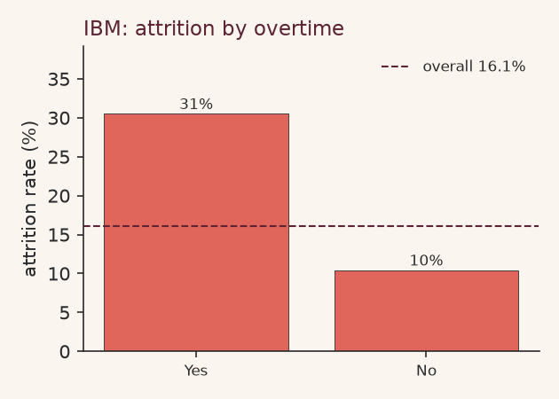 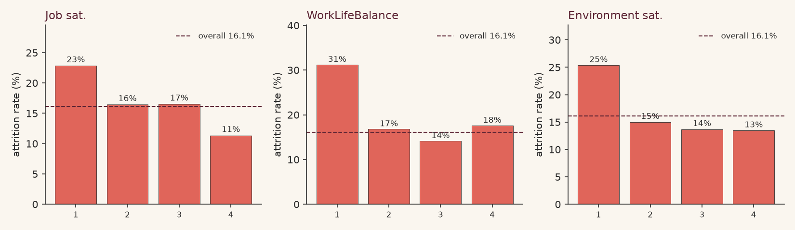

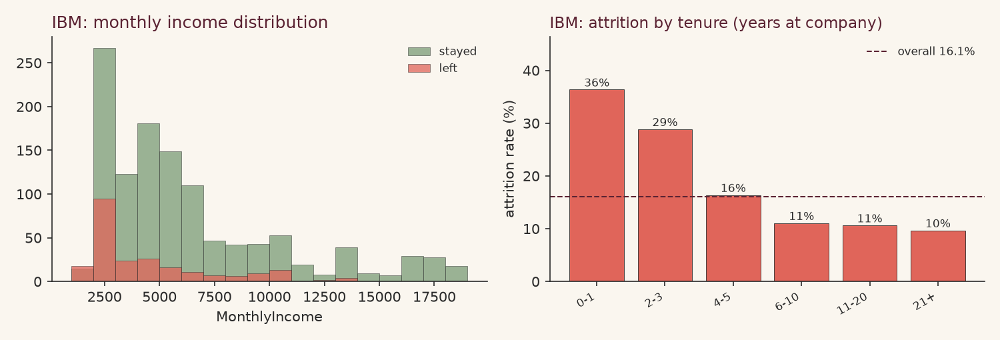 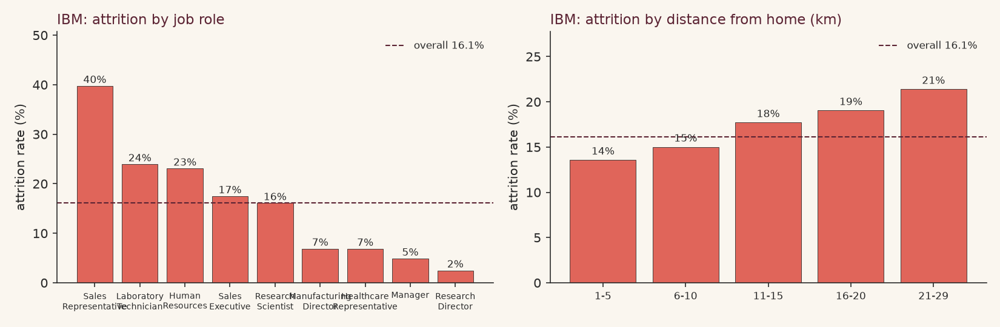 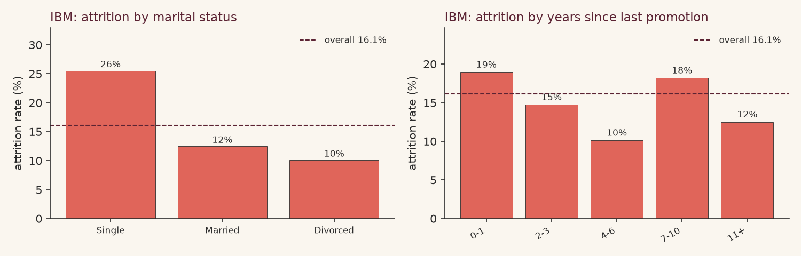

### 4.2 Real company HRIS (n=14,995, attrition 23.8%)

Categorical associations:

| feature | n | p (chi2) | Cramer's V | highest attrition levels |
|---|---|---|---|---|
| number_project | 14995 | 0.00e+00 | 0.598 | 7: 100.0%; 2: 65.6%; 6: 55.8% |
| salary_band | 14995 | 2.61e-83 | 0.159 | low: 29.7%; medium: 20.4%; high: 6.6% |
| Work_accident | 14995 | 1.35e-79 | 0.154 | 0: 26.5%; 1: 7.8% |
| department | 14995 | 7.61e-15 | 0.076 | hr: 29.1%; accounting: 26.6%; technical: 25.6% |
| promotion_last_5years | 14995 | 6.66e-14 | 0.061 | 0: 24.2%; 1: 6.0% |

Numeric differences:

| feature | n | mean left vs stayed | median left vs stayed | p (Mann-Whitney) | Cohen's d |
|---|---|---|---|---|---|
| satisfaction_level | 14995 | 0.44 vs 0.67 | 0.41 vs 0.69 | 0.00e+00 | -0.989 |
| time_spend_company | 14995 | 3.88 vs 3.38 | 4.00 vs 3.00 | 1.25e-237 | +0.344 |
| average_montly_hours | 14995 | 207.43 vs 199.06 | 224.00 vs 198.00 | 1.26e-08 | +0.168 |
| last_evaluation | 14995 | 0.72 vs 0.72 | 0.79 vs 0.71 | 0.772 | +0.016 |

Odds ratios: low salary **OR 1.90** [1.76–2.05];
**no promotion in 5 years OR 5.03** [3.16–8.02];
work accident **OR 0.23** (protective — see discussion).

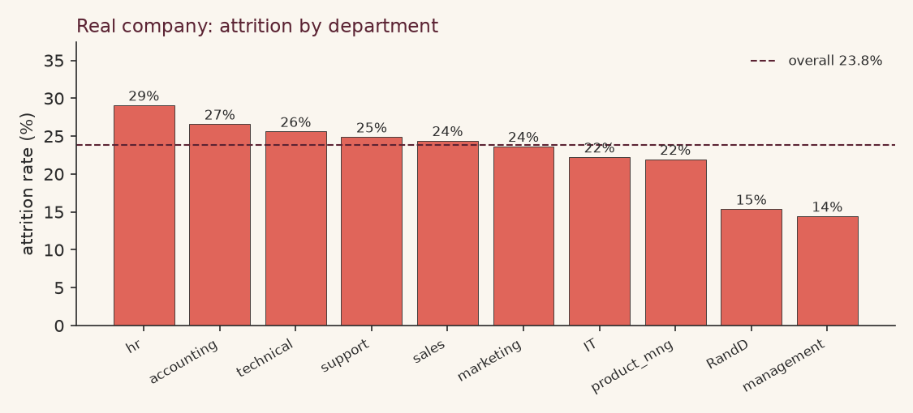 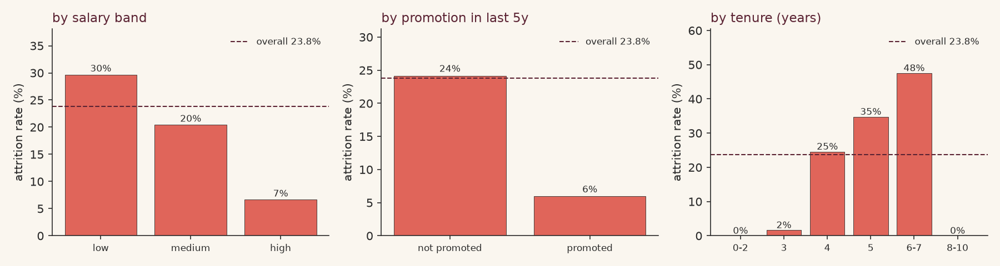

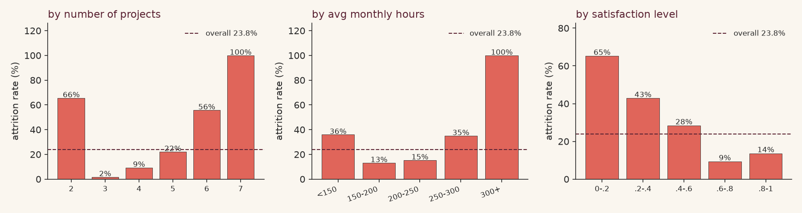 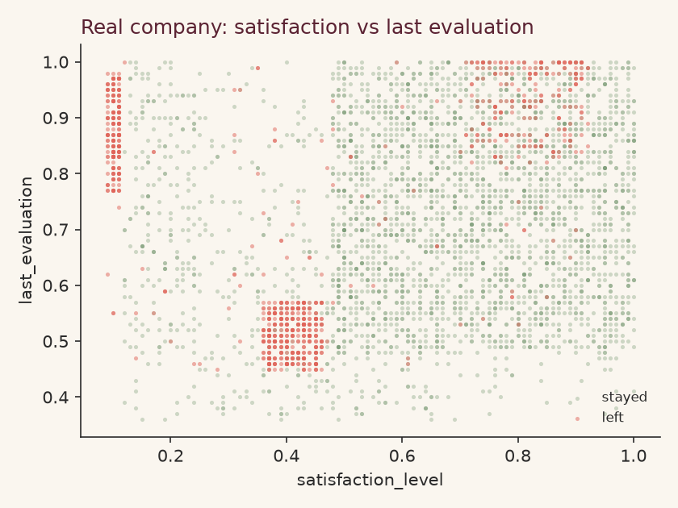

### 4.3 Real job-change candidates (n=18,359, seeking change 13.2%)

Categorical associations:

| feature | n | p (chi2) | Cramer's V | highest attrition levels |
|---|---|---|---|---|
| experience_cat | 18300 | 1.97e-30 | 0.104 | <1: 24.3%; 1: 23.9%; 2: 17.2% |
| enrolled_university | 18017 | 1.78e-28 | 0.084 | Full time course: 19.0%; Part time course: 14.9%; no_enrollment: 11.6% |
| relevent_experience | 18359 | 1.33e-23 | 0.074 | No relevent experience: 17.4%; Has relevent experience: 11.7% |
| education_level | 17902 | 7.26e-06 | 0.040 | Graduate: 14.2%; Masters: 11.9%; High School: 11.9% |
| company_type | 13320 | 6.95e-05 | 0.045 | Other: 16.0%; Public Sector: 15.3%; NGO: 12.9% |
| gender | 14261 | 0.010 | 0.026 | Other: 15.3%; Female: 15.1%; Male: 12.2% |
| company_size | 13580 | 0.019 | 0.035 | 10/49: 13.4%; 5000-9999: 12.5%; 10000+: 12.1% |
| last_new_job | 17992 | 9.59e-04 | 0.034 | never: 14.2%; 4: 14.2%; 2: 13.7% |
| major_discipline | 15521 | 0.216 | 0.021 | STEM: 13.7%; Humanities: 13.5%; Business Degree: 12.7% |

Numeric differences:

| feature | n | mean left vs stayed | median left vs stayed | p (Mann-Whitney) | Cohen's d |
|---|---|---|---|---|---|
| city_development_index | 18359 | 0.81 vs 0.85 | 0.89 vs 0.91 | 2.62e-43 | -0.405 |
| experience_num | 18300 | 9.00 vs 10.73 | 7.00 vs 10.00 | 1.00e-35 | -0.262 |
| training_hours | 18359 | 65.16 vs 66.01 | 47.00 vs 47.00 | 0.390 | -0.014 |

Odds ratios: no relevant experience **OR 1.59** [1.45–1.74];
graduate education **OR 1.26** [1.15–1.37].

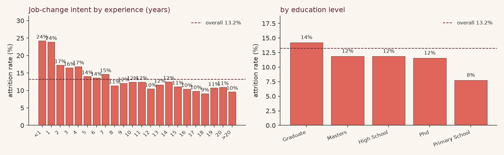 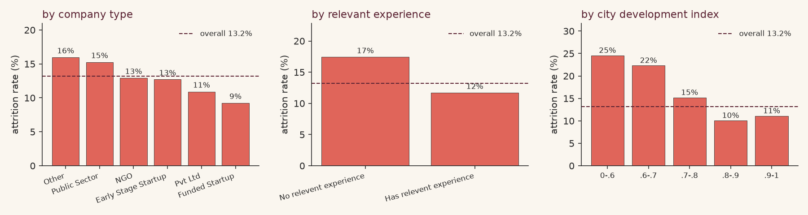 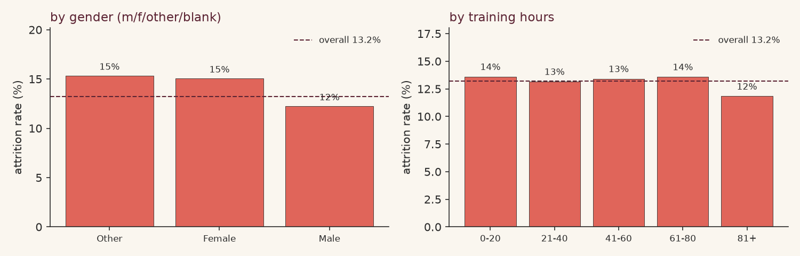

### 4.4 Real faculty census 2011→2017 (n=6,793, left field 22.9%)

| feature | n | p (chi2) | Cramer's V | highest attrition levels |
|---|---|---|---|---|
| title_2011 | 6793 | 2.20e-160 | 0.330 | Full Professor: 34.0%; Assistant Professor: 30.3%; Associate Professor: 27.2% |
| sex | 5017 | 0.052 | 0.034 | M: 31.6%; F: 27.5%; .: 14.3% |

Sex odds ratio (F vs M): **OR 0.82** [0.69–0.98].
Across 205 departments the attrition fraction ranges
**0.0%–94%**
(mean 33.8%, median 33.3%,
headcount-weighted 34.6%).

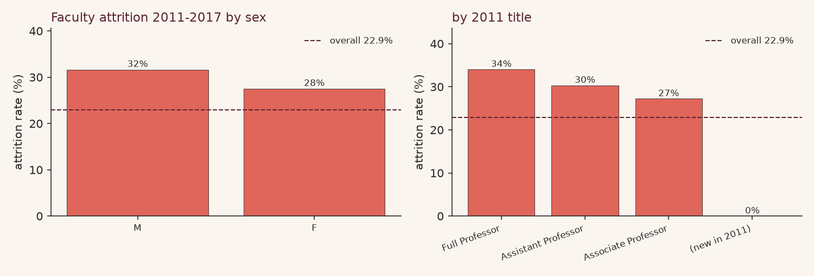 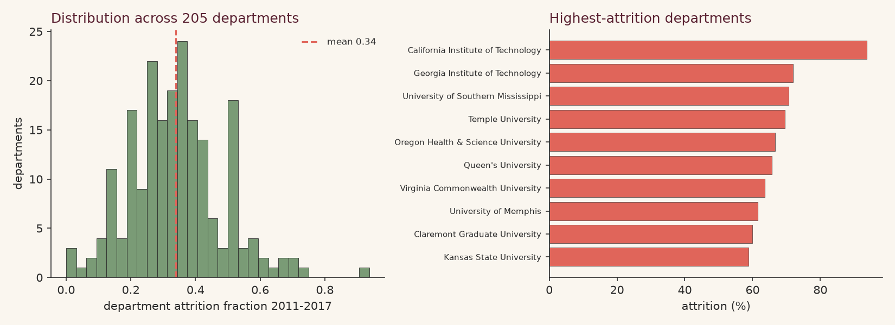

### 4.5 Predictive models

**Best model by 5-fold CV ROC-AUC: `logreg`** (n=1,470, held-out test n=294, test base rate 16.0%).

| model | CV ROC-AUC | CV PR-AUC | CV F1 | CV recall |
|---|---|---|---|---|
| logreg | 0.819±0.025 | 0.595 | 0.493 | 0.711 |
| rf | 0.803±0.022 | 0.539 | 0.513 | 0.442 |
| xgb | 0.800±0.030 | 0.541 | 0.506 | 0.416 |

| test ROC-AUC | test PR-AUC | accuracy | precision | recall (leavers) | F1 | Brier | confusion [[TN,FP],[FN,TP]] |
|---|---|---|---|---|---|---|---|
| 0.840 | 0.595 | 0.782 | 0.400 | 0.723 | 0.515 | 0.150 | [[196, 51], [13, 34]] |

Top permutation importances (test set, drop in ROC-AUC):

| feature | importance |
|---|---|
| OverTime | 0.0764 |
| YearsAtCompany | 0.0435 |
| YearsSinceLastPromotion | 0.0418 |
| JobRole | 0.0312 |
| NumCompaniesWorked | 0.0281 |
| EnvironmentSatisfaction | 0.0262 |
| BusinessTravel | 0.0238 |
| JobSatisfaction | 0.0197 |
| DistanceFromHome | 0.0173 |
| EducationField | 0.0172 |

Top SHAP mean |value| (test sample):

| feature | mean |SHAP| |
|---|---|
| num__YearsAtCompany | 0.4529 |
| num__YearsInCurrentRole | 0.4087 |
| num__JobSatisfaction | 0.3975 |
| num__TotalWorkingYears | 0.3870 |
| num__YearsWithCurrManager | 0.3567 |
| cat__OverTime_No | 0.3429 |
| cat__MaritalStatus_Single | 0.3335 |
| num__EnvironmentSatisfaction | 0.3290 |
| num__NumCompaniesWorked | 0.3100 |
| cat__MaritalStatus_Divorced | 0.2943 |

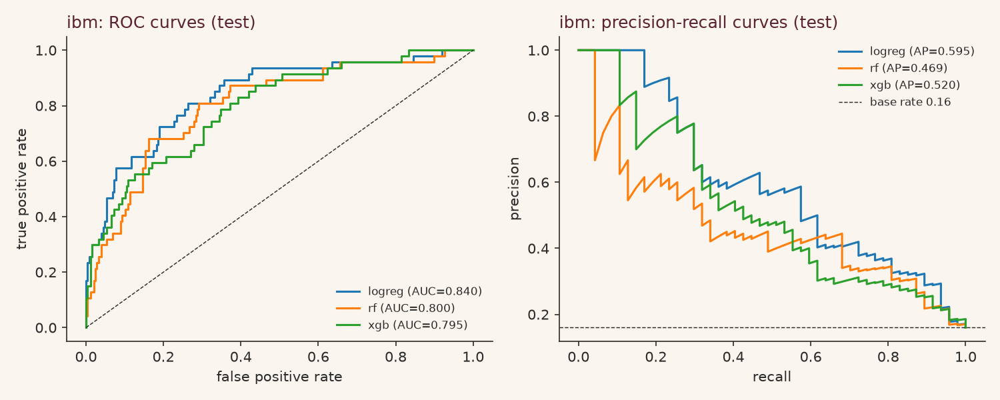 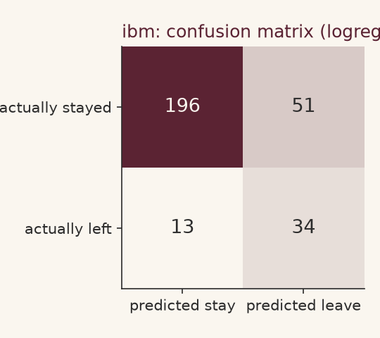 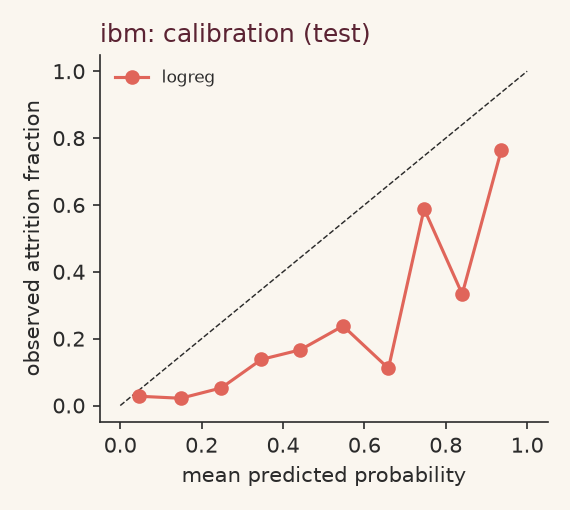

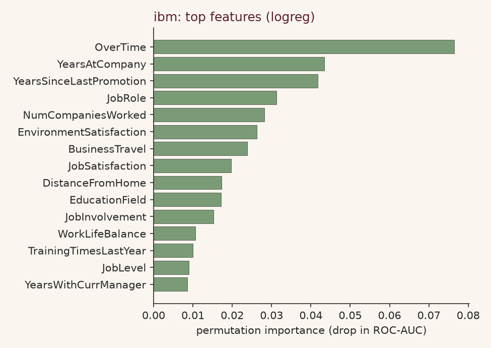 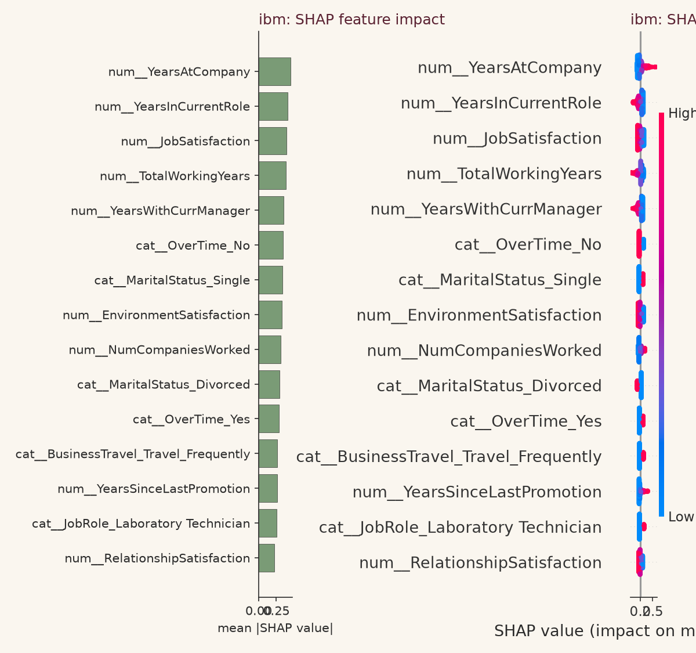

**Best model by 5-fold CV ROC-AUC: `xgb`** (n=14,995, held-out test n=2,999, test base rate 23.8%).

| model | CV ROC-AUC | CV PR-AUC | CV F1 | CV recall |
|---|---|---|---|---|
| logreg | 0.827±0.014 | 0.493 | 0.611 | 0.795 |
| rf | 0.993±0.003 | 0.986 | 0.953 | 0.926 |
| xgb | 0.994±0.002 | 0.989 | 0.970 | 0.970 |

| test ROC-AUC | test PR-AUC | accuracy | precision | recall (leavers) | F1 | Brier | confusion [[TN,FP],[FN,TP]] |
|---|---|---|---|---|---|---|---|
| 0.995 | 0.990 | 0.983 | 0.957 | 0.972 | 0.965 | 0.014 | [[2255, 31], [20, 693]] |

Top permutation importances (test set, drop in ROC-AUC):

| feature | importance |
|---|---|
| satisfaction_level | 0.1345 |
| time_spend_company | 0.0505 |
| average_montly_hours | 0.0147 |
| number_project | 0.0143 |
| last_evaluation | 0.0140 |
| salary_band | 0.0016 |
| department | 0.0010 |
| Work_accident | 0.0005 |
| promotion_last_5years | 0.0000 |

Top SHAP mean |value| (test sample):

| feature | mean |SHAP| |
|---|---|
| num__satisfaction_level | 2.5008 |
| num__time_spend_company | 1.2605 |
| num__average_montly_hours | 0.9704 |
| num__last_evaluation | 0.9226 |
| num__number_project | 0.8937 |
| num__Work_accident | 0.2928 |
| cat__salary_band_low | 0.2830 |
| cat__salary_band_high | 0.1418 |
| cat__department_sales | 0.1075 |
| cat__department_product_mng | 0.0793 |

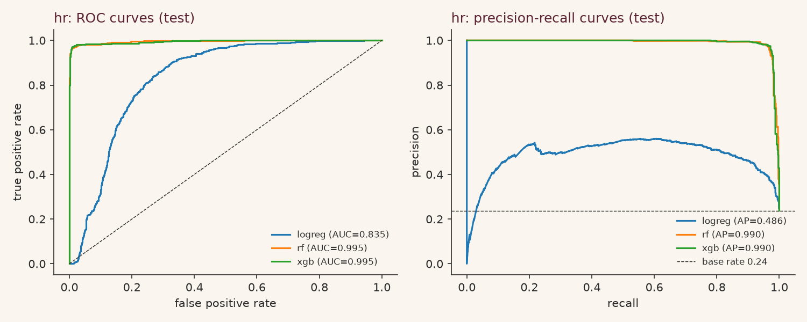 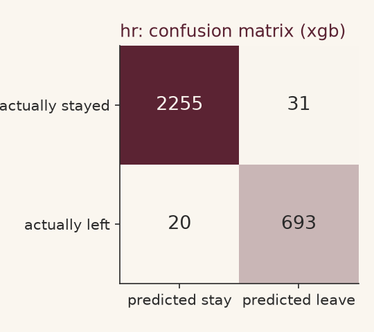 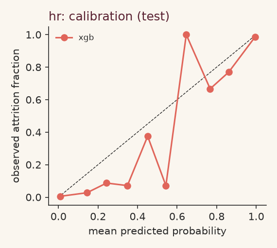

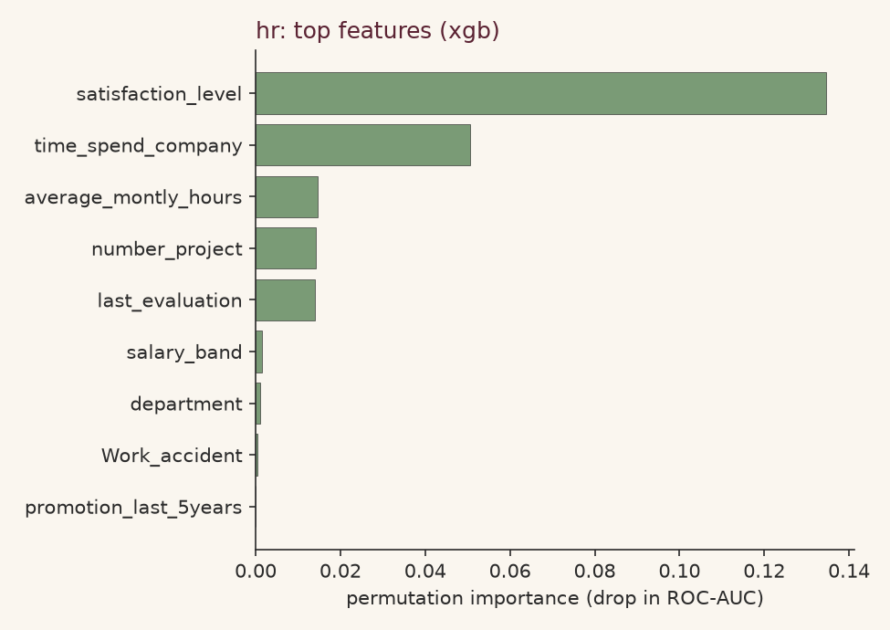 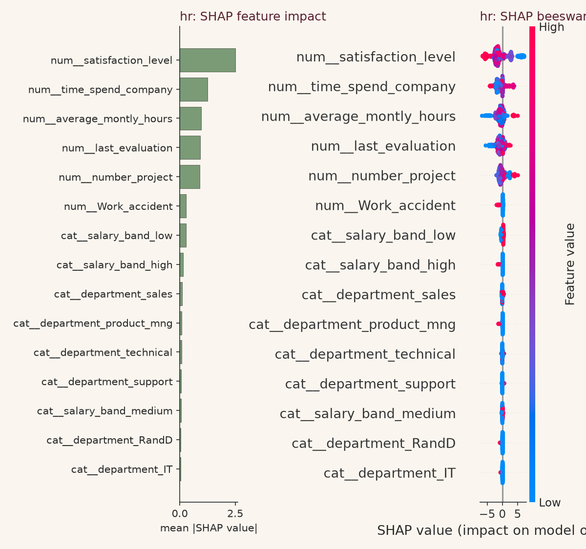

**Best model by 5-fold CV ROC-AUC: `rf`** (n=18,359, held-out test n=3,672, test base rate 13.2%).

| model | CV ROC-AUC | CV PR-AUC | CV F1 | CV recall |
|---|---|---|---|---|
| logreg | 0.637±0.012 | 0.210 | 0.290 | 0.560 |
| rf | 0.641±0.012 | 0.212 | 0.267 | 0.307 |
| xgb | 0.610±0.016 | 0.201 | 0.266 | 0.386 |

| test ROC-AUC | test PR-AUC | accuracy | precision | recall (leavers) | F1 | Brier | confusion [[TN,FP],[FN,TP]] |
|---|---|---|---|---|---|---|---|
| 0.630 | 0.218 | 0.781 | 0.246 | 0.320 | 0.278 | 0.172 | [[2713, 474], [330, 155]] |

Top permutation importances (test set, drop in ROC-AUC):

| feature | importance |
|---|---|
| city_development_index | 0.0639 |
| company_size | 0.0162 |
| experience_num | 0.0141 |
| relevent_experience | 0.0134 |
| enrolled_university | 0.0079 |
| last_new_job | 0.0034 |
| company_type | 0.0028 |
| education_level | -0.0014 |
| gender | -0.0017 |
| major_discipline | -0.0030 |

Top SHAP mean |value| (test sample):

| feature | mean |SHAP| |
|---|---|
| num__city_development_index | 0.0592 |
| num__experience_num | 0.0311 |
| num__training_hours | 0.0272 |
| cat__company_size_50-99 | 0.0259 |
| cat__relevent_experience_No relevent experience | 0.0161 |
| cat__relevent_experience_Has relevent experience | 0.0136 |
| cat__enrolled_university_no_enrollment | 0.0130 |
| cat__education_level_Graduate | 0.0127 |
| cat__enrolled_university_Full time course | 0.0116 |
| cat__last_new_job_1 | 0.0092 |

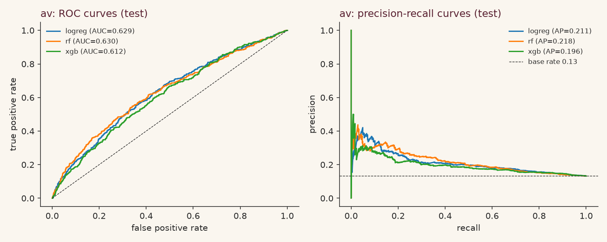 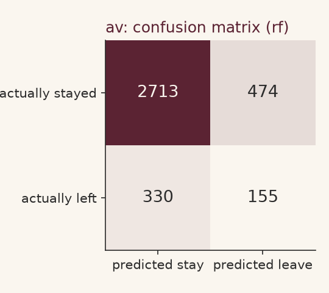 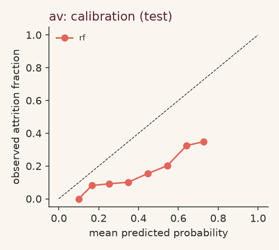

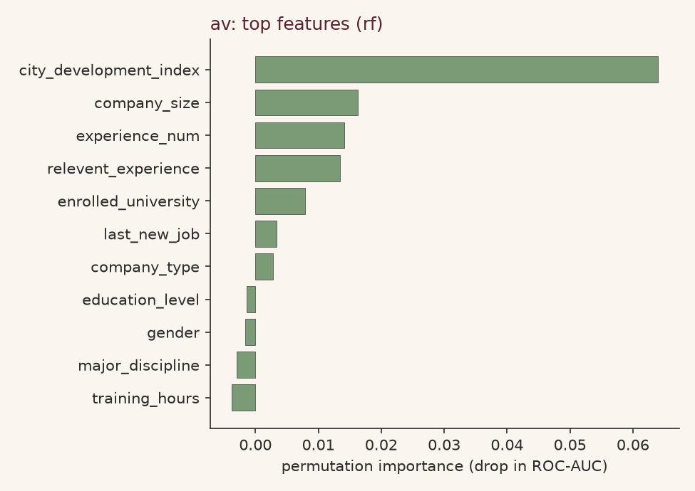 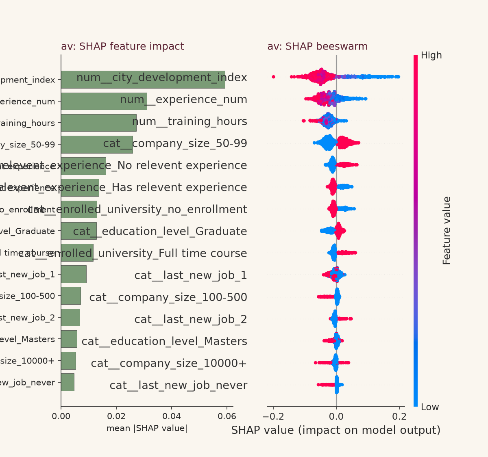

**Best model by 5-fold CV ROC-AUC: `logreg`** (n=6,793).

| model | CV ROC-AUC | CV PR-AUC |
|---|---|---|
| logreg | 0.695±0.011 | 0.331 |

_Note: title/sex only; no rich covariates available_


## 5. What the study found (synthesis)

1. **Overtime and workload are the strongest categorical levers in the IBM sample**
   (overtime: 30.5% vs 10.4% attrition, OR 3.77, Cramér's V 0.24). In the real company data the equivalent signal is extreme
   project load: employees with **7 projects left 100% of the time** (V=0.60).
2. **Satisfaction is the single biggest numeric driver in the real company data**
   (Cohen's d -0.99; mean 0.44 for leavers vs 0.67 for stayers) and the top SHAP feature.
3. **Pay and promotion stagnation matter.** Low salary band OR 1.90 (real company) and mean monthly income of leavers is
   $4,787 vs $6,833 in the IBM sample (d -0.44); in the real company, **not being promoted in 5 years carries OR 5.03**.
4. **Early tenure is a danger zone** — in IBM, leavers average 5.1 years at the company vs 7.4 (d -0.37) and `YearsAtCompany` is the top permutation/SHAP feature; in the job-change data, candidates with <1–1 year of experience seek new jobs at 24.3% / 23.9% vs 13.2% overall.
5. **Context, not demographics, dominates.** City development index (d -0.40) and company type beat gender in the job-change data; in IBM, gender (p=0.291) and performance rating are unrelated to attrition.
6. **In academia the pattern flips by rank**: full professors leave most (34.0% — largely retirement), and women are *less* likely to leave than men (OR 0.82). Department-level attrition varies enormously (0.0%–94%), so institution-level factors matter.
7. **Predictability is dataset-dependent**: near-perfect on the real company HRIS (test ROC-AUC 0.995, but see limitations), good on the IBM sample (0.84), and only modest for job-change intent (0.63, PR-AUC 0.22 vs base rate 13.2%). Attrition *intent* is harder to predict than recorded exits.

## 6. Discussion — practical implications for HR

- **Watch overtime and project load first** — they are the most actionable and most strongly associated with leaving.
- **Run retention conversations in years 0–3** and around promotion cycles (the "no promotion in 5 years" group is the highest-risk in the real data).
- **Audit pay bands by role** — low salary and low income are replicated risk markers; check Sales-type roles (IBM sales roles reach 39.8%).
- **Fix satisfaction drivers, not demographics** — gender/performance show no signal in the IBM sample; satisfaction and work-life balance do.
- **Use models as triage, not verdicts** — probabilities flag *who to talk to*, never *what to decide*; the 30/60 risk bands in the UI are demo conventions, not validated thresholds.

## 7. Limitations

- The IBM file is **synthetic** (created by IBM data scientists); treat its numbers as a benchmark, not evidence about real employees.
- The real company HRIS is nearly perfectly separable (test ROC-AUC 0.995) — consistent with the known structure of this widely used dataset (project count/tenure/satisfaction interact almost deterministically). Real-world HR data is usually noisier; do not expect 0.99 AUC in production.
- Job-change *intent* (AV) is self-reported and only weakly predictable (0.63); the AV file also has substantial missingness (see `reports/results/eda_all.json`).
- The faculty census covers one field (physics) at PhD-granting US departments, 2011→2017; "left" means left the census, not necessarily left employment.
- All datasets are cross-sectional snapshots or one transition window — **no causal claims**; associations only.
- Class imbalance (13–34% positive) means accuracy is misleading; we report PR-AUC and recall for leavers.

## 8. Responsible use

This is an educational demonstration, **not an employment-decision system**.
Models like these must never be used alone to discipline, rank, or deny
opportunities to real employees; any deployment needs human review, fairness
audits across protected groups, privacy safeguards, and local legal review
(e.g., GDPR/EEOC constraints on automated employment decisions). No dataset
here contains direct identifiers.

## 9. Reproducibility

```sh
python3 -m venv .venv && .venv/bin/pip install -r analysis/requirements.txt
python3 data/fetch_datasets.py            # optional: re-download + verify external data
python3 analysis/run_all.py               # eda.py -> modeling.py -> report.py
# Python prediction service (implements docs/backend-contract.md):
cd backend && ../.venv/bin/pip install -r requirements.txt
../.venv/bin/python train.py               # trains + writes backend/artifacts/
../.venv/bin/python -m pytest test_api.py  # contract tests
../.venv/bin/uvicorn app:app --host 0.0.0.0 --port 8000
```

Raw computed results: `reports/results/eda_all.json`, `reports/results/model_all.json`.
Figures: `reports/figures/`. Frontend contract: `docs/backend-contract.md`.

## 10. References

1. IBM HR Analytics Employee Attrition & Performance dataset (Kaggle, pavansubhasht) — fictional sample; GitHub mirror `IamVasil/IBM-HR-Analytics-Employee-Attrition-Performance`.
2. Kaggle "HR Analytics" (`HR_comma_sep.csv`) — anonymized real company HRIS export; mirror `github.com/KunalKurve/Machine-Learning`.
3. Analytics Vidhya JanataHack — "HR Analytics: Job Change of Data Scientists" hackathon data; mirror `github.com/aasu14/Data-Science-Hackathon-And-Competition`.
4. Morgan, A. C., Way, S. F., & Clauset, A. (2018). *Automatically assembling a full census of an academic field.* arXiv:1804.02760 — supplementary data `github.com/allisonmorgan/academic_census`.
5. scikit-learn, XGBoost, SHAP documentation (modeling and explainability methods).
